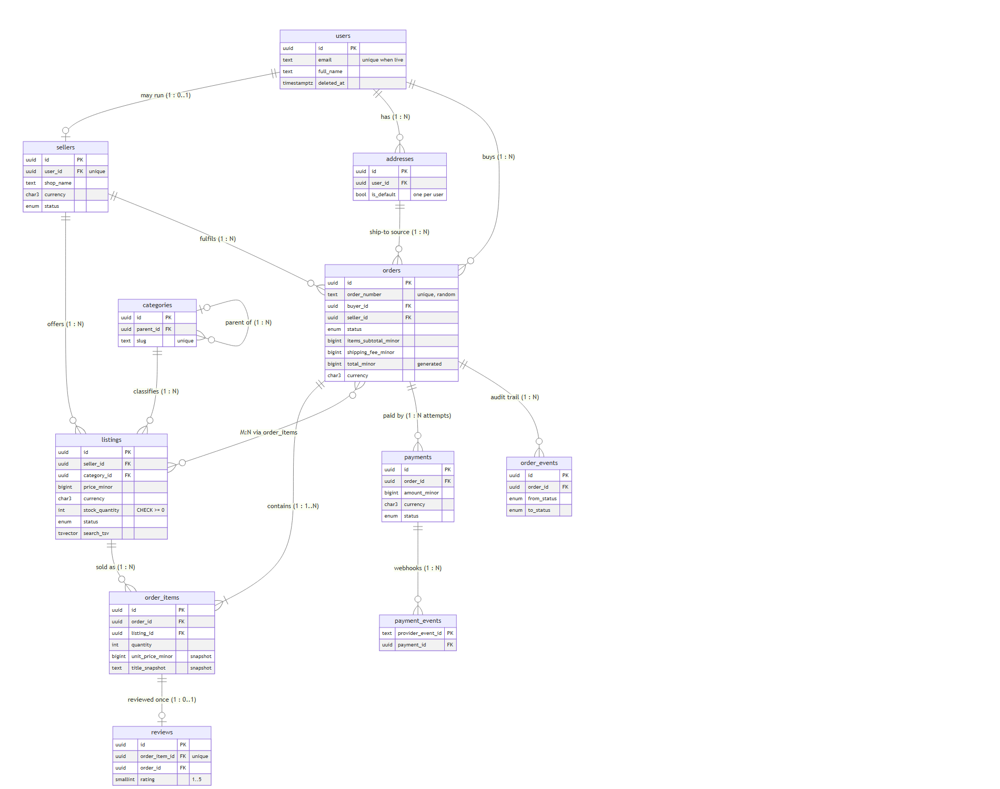

# 2. Data model

Implemented in [`db/migrations/001_init.up.sql`](../db/migrations/001_init.up.sql); every table, constraint and index named below exists there (a generated listing is in [`evidence/00_schema_listing.txt`](../evidence/00_schema_listing.txt)).

Conventions on every table: `id uuid` primary key generated by `uuidv7()`; `created_at`/`updated_at timestamptz NOT NULL DEFAULT now()` (exceptions in §3.4); money is `bigint` minor units with a `currency char(3)` beside it.

## Diagram

Source: [`diagrams/er.mmd`](../diagrams/er.mmd) (Mermaid).

## Relationships and cardinality

| Relationship | Cardinality | Implemented by |
|---|---|---|
| user → seller | **1 : 0..1** | `sellers.user_id` is `UNIQUE NOT NULL` |
| user → addresses | 1 : N | `addresses.user_id` FK |
| user (buyer) → orders | 1 : N | `orders.buyer_id` FK |
| seller → listings | 1 : N | `listings.seller_id` FK |
| seller → orders | 1 : N | `orders.seller_id` FK |
| category → listings | 1 : N | `listings.category_id` FK |
| category → category | 1 : N (tree) | `categories.parent_id` self-FK, `CHECK parent_id <> id` |
| address → orders | 1 : N | `orders.shipping_address_id` FK |
| **order ↔ listing** | **M : N** | join table **`order_items`** (below) |
| order → payments | 1 : N (attempts) | `payments.order_id`; at most one *live* via partial unique index |
| order → order_events | 1 : N | `order_events.order_id` FK, append-only |
| payment → payment_events | 1 : N | `payment_events.payment_id` FK |
| order_item → review | **1 : 0..1** | `reviews.order_item_id` `UNIQUE` |

**The many-to-many.** An order has many listings; a listing is in many orders. The join table `order_items` is not a bare pair of foreign keys; it has its own constraints: `UNIQUE (order_id, listing_id)` (one line per listing, quantity carries the count), `quantity BETWEEN 1 AND 999`, a **price and title snapshot**, `seller_id`/`currency` copies that two composite FKs check against *both* parents (so a line can only join an order and a listing of the same seller and currency), and a trigger that makes lines immutable and reserves stock.

## Entities

Legend: **R** = required (`NOT NULL`), **O** = optional. Types are PostgreSQL types.

### users: a person's identity and PII
Identifier `id uuid`.

| Field | Type | | Notes |
|---|---|---|---|
| id | uuid | R | `uuidv7()` |
| email | text | R* | unique among live users, case-insensitive; format checked |
| full_name | text | R* | 1 to 120 chars |
| phone_e164 | text | O | `+` and 8 to 15 digits |
| created_at, updated_at | timestamptz | R | |
| deleted_at | timestamptz | O | set on erasure |

\*Required **unless erased**: `users_pii_present_unless_erased` allows NULLs only when `deleted_at` is set.

### addresses: where a user can receive goods
| Field | Type | | Notes |
|---|---|---|---|
| id | uuid | R | |
| user_id | uuid | R | FK users |
| recipient_name, line1, city, postal_code | text | R | |
| line2, region, phone_e164 | text | O | |
| country | char(2) | R | ISO 3166 shape `^[A-Z]{2}$` |
| is_default | boolean | R | at most one live default per user |
| created_at, updated_at, deleted_at | timestamptz | R, R, O | |

### sellers: a shop (a user who sells)
| Field | Type | | Notes |
|---|---|---|---|
| id | uuid | R | |
| user_id | uuid | R | FK users, **UNIQUE** (1:0..1) |
| shop_name | text | R | 2 to 80 |
| shop_slug | text | R | lowercase-kebab, unique among live shops |
| currency | char(3) | R | the shop's single currency |
| flat_shipping_fee_minor | bigint | R | default 0, `>= 0` |
| status | seller_status | R | `pending_review` (default), `active`, `suspended` |
| created_at, updated_at, deleted_at | timestamptz | R, R, O | |

### categories: product taxonomy (tree)
`id`, `parent_id` (O, self-FK), `name` (R), `slug` (R, unique), `is_active` (R, default true), `created_at`, `updated_at`.

### listings: a thing for sale
| Field | Type | | Notes |
|---|---|---|---|
| id | uuid | R | |
| seller_id | uuid | R | with `currency`: composite FK to `sellers(id, currency)` |
| category_id | uuid | R | FK categories |
| title | text | R | 3 to 140 |
| description | text | R | default `''`, max 5000 |
| price_minor | bigint | R | `> 0` (`listings_price_positive`) |
| currency | char(3) | R | must equal the seller's |
| stock_quantity | integer | R | `>= 0` (`listings_stock_nonneg`) |
| status | listing_status | R | `draft` (default), `active`, `paused` |
| rating_sum, rating_count | bigint, integer | R | cached aggregate of live reviews; trigger-maintained |
| search_tsv | tsvector | R | generated from title + description |
| created_at, updated_at, deleted_at | timestamptz | R, R, O | |

### orders: one buyer buying from one seller
| Field | Type | | Notes |
|---|---|---|---|
| id | uuid | R | |
| order_number | text | R | `DK-` + 12 random hex; unique; the customer-facing reference |
| buyer_id | uuid | R | FK users |
| seller_id, currency | uuid, char(3) | R | composite FK to `sellers(id, currency)` |
| status | order_status | R | `pending_payment` (default), `paid`, `shipped`, `delivered`, `completed`, `cancelled`, `refunded` |
| items_subtotal_minor | bigint | R | trigger-maintained sum of line totals |
| shipping_fee_minor | bigint | R | copied from the seller at creation |
| total_minor | bigint | R | **generated**: subtotal + fee |
| shipping_address_id | uuid | R | composite FK `(id, buyer_id)`: must be the buyer's own address |
| seller_shop_name_snapshot, ship_recipient, ship_line1, ship_city, ship_postal_code, ship_country | text / char(2) | R | frozen copies, filled by trigger |
| ship_line2, ship_region | text | O | |
| carrier, tracking_number | text | O | required once shipped (`orders_shipped_has_tracking`) |
| paid_at, shipped_at, delivered_at, completed_at, cancelled_at | timestamptz | O | each required by its status, ordered by `orders_timestamps_ordered` |
| cancelled_by | actor_kind | O | required when cancelled |
| created_at, updated_at | timestamptz | R | no `deleted_at`: orders are never deleted |

### order_items: the order to listing join
| Field | Type | | Notes |
|---|---|---|---|
| id | uuid | R | |
| order_id, listing_id | uuid | R | |
| seller_id, currency | uuid, char(3) | R | copied from listing, FK-checked against order **and** listing |
| quantity | integer | R | 1 to 999 |
| unit_price_minor | bigint | R | price **at purchase** |
| title_snapshot | text | R | title **at purchase** |
| line_total_minor | bigint | R | generated: `quantity * unit_price_minor` |
| created_at, updated_at | timestamptz | R | |

### order_events: append-only status history
`id`, `order_id` (FK), `from_status` (O, null at birth), `to_status` (R), `actor_type` (`buyer|seller|system|staff`), `actor_id` (O), `created_at`. A trigger rejects `UPDATE` and `DELETE`.

### payments: one attempt to collect an order's total
| Field | Type | | Notes |
|---|---|---|---|
| id | uuid | R | |
| order_id, currency | uuid, char(3) | R | composite FK to `orders(id, currency)` |
| amount_minor | bigint | R | `> 0`, must equal the order total (trigger) |
| status | payment_status | R | `pending` (default), `authorized`, `captured`, `failed`, `voided`, `refunded` |
| provider | text | R | e.g. `paystack` |
| provider_reference | text | O | unique per provider |
| failure_code | text | O | required when failed |
| captured_at | timestamptz | O | required when captured/refunded; set by trigger |
| created_at, updated_at | timestamptz | R | |

### payment_events: webhook ledger
`provider_event_id text` **is the primary key**, so a replayed webhook cannot be processed twice. Also `payment_id`, `event_type`, `payload jsonb`, `created_at`.

### reviews
| Field | Type | | Notes |
|---|---|---|---|
| id | uuid | R | |
| order_item_id, order_id, listing_id | uuid | R | one composite FK to `order_items(id, order_id, listing_id)` |
| buyer_id | uuid | R | |
| order_status | order_status | R | constant `'completed'` (CHECK); exists only so a composite FK to `orders(id, buyer_id, status)` can demand a completed order |
| rating | smallint | R | 1 to 5 |
| body | text | O | max 2000; the only editable field |
| created_at, updated_at, deleted_at | timestamptz | R, R, O | soft delete = moderation takedown |

### idempotency_keys
PK `(principal_id, idem_key)`, `request_method`, `request_path`, `request_hash`, `response_status` (NULL while in flight), `response_body jsonb`, `created_at`, `updated_at`, `expires_at` (default +24 h). Hard-deleted after expiry.

### state_transitions: reference data
`(entity, from_status, to_status)`: one row per **allowed** transition. See §3.3.

## Enumerations
`seller_status`, `listing_status`, `order_status`, `payment_status`, `actor_kind`. Native enums: invalid values are rejected at the type level, and adding one is a deliberate migration. Removing one is awkward in PostgreSQL, which is acceptable because status values are part of the public API contract anyway.
