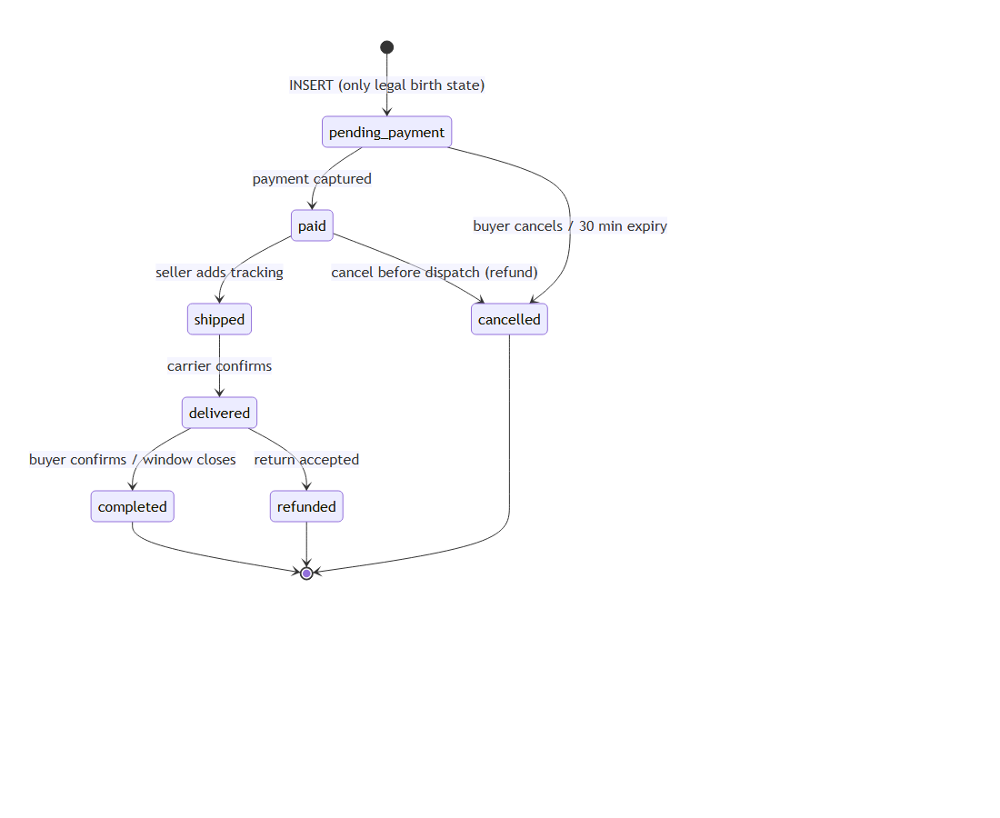

# The order status I thought was harmless turned out to be a money bug

I was designing a marketplace's order lifecycle, and I drew the happy path first because that's what everyone draws: `pending_payment → paid → shipped → delivered → completed`. It looked finished. Then I did the exercise that actually matters: write down *every* cell of the transition table, including the ones that should be forbidden.

Seven statuses give 42 possible moves between different statuses. I'd drawn seven arrows, so 35 cells were forbidden. Most were obviously dead: you can't go from `completed` back to `shipped`. A handful weren't obvious at all.



## The cell that surprised me: `cancelled → paid`

Nobody would write code that moves a cancelled order to paid. So why did I have to *forbid* it?

Because someone else writes it for you. A buyer starts paying, wanders off, and the order expires after 30 minutes. A job moves it to `cancelled` and the stock goes back on the shelf. Then the payment provider's webhook arrives: *captured*. The money really moved.

Now the system faces a choice it never made explicitly:

- **Resurrect the order** (`cancelled → paid`). But the stock may already belong to another buyer. You've sold the same thing twice.
- **Ignore the payment.** You've kept someone's money for an order that doesn't exist.

Neither is acceptable, and the "just flip the status" code path that webhook handlers love to take makes the first one happen silently. Forbidding the transition in the database forced a third design: the payment row records the truth (`captured`), the order stays `cancelled`, and a reconciliation query finds orders where `status = 'cancelled' AND payment.status = 'captured'` and feeds them to a refund queue.

The forbidden arrow wasn't a restriction. It was a missing feature, found by drawing the table.

```
UPDATE orders SET status = 'paid' WHERE id = '…';
ERROR:  DK001: illegal order transition: cancelled -> paid
```

## Two more that fell out of the same exercise

**`shipped → cancelled` is forbidden.** The parcel is in a van. "Cancel" would restock inventory that's on the road. The legal path is deliver, then return: `delivered → refunded`.

**`completed → refunded` is forbidden, but `delivered → refunded` is allowed.** One word apart, completely different. `completed` is the buyer saying "I'm happy", which closes the return window and is also the only state from which a review may be written. If `completed` could be refunded, a refunded order could carry a five-star review. The single status that gates reviews has to be terminal.

## How the database holds the line

The allowed transitions are *rows*, not `if` statements:

```sql
INSERT INTO state_transitions (entity, from_status, to_status) VALUES
  ('order', 'pending_payment', 'paid'), ('order', 'pending_payment', 'cancelled'),
  ('order', 'paid', 'shipped'),         ('order', 'paid', 'cancelled'),
  ('order', 'shipped', 'delivered'),    ('order', 'delivered', 'completed'),
  ('order', 'delivered', 'refunded');
```

A trigger asks "is there a row for this from/to?" and refuses anything else. A second layer says an order can only be *born* `pending_payment` and can only become `paid` if a captured payment exists. The review rule uses no code at all: a foreign key to `(order_id, buyer_id, 'completed')`, so a review of an unfinished order has nothing to point at.

## And a smaller surprise about the error, not the rule

My first version checked "is this order read-only?" before "is this transition legal?". So trying `completed → shipped` reported *read-only*, not *illegal transition*. Both are rejections, but an API needs to tell a client the difference between "you can't do that *now*" and "you can't edit that *ever*". The order of two `IF`s changed which error code a user sees.

## What I'd tell you to do

1. Draw the whole grid, not the arrows. The blanks are where your bugs live.
2. For each forbidden cell, ask "who will try this, and what do I want to happen instead?" If you don't have an answer, you've found a missing requirement.
3. Make the table data, enforce it where every writer has to pass, and keep the forbidden cells *tested*. Mine are rejected inserts with captured output, not just a diagram.

---
*Schema, seeds, plans and the rejected inserts: [`db/`](../db/) and [`evidence/`](../evidence/). Full design: [`README`](../README.md).*
